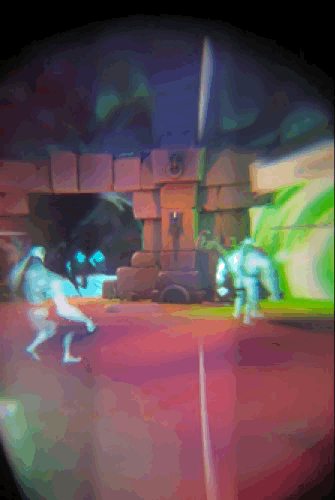
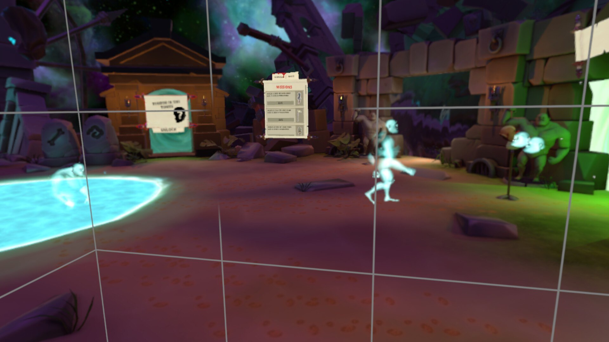
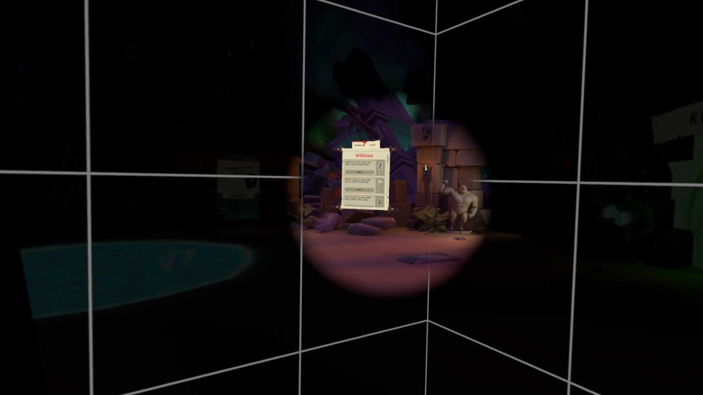
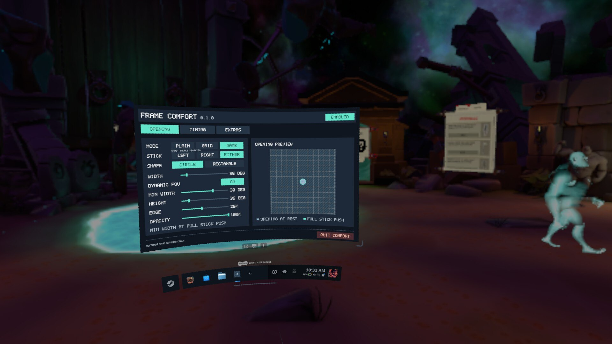

# Frame Comfort

A standalone Steam Frame app that helps with cybersickness caused by
smooth locomotion. It runs entirely on the headset and works with local and
PC-streamed games. No PC companion is needed.

While you move with a thumbstick, the middle of your view stays live and the
periphery holds still, fixed to your real room. Your eyes keep a stable
reference while the game moves. Release the stick and normal VR fades back.

<p align="center">
  
  <br>
  <em>Moving with the thumbstick: the centre stays live, the periphery holds still.</em>
</p>

The periphery can show a frozen snapshot of the game that refreshes about
once a second (**Game**), black (**Plain**) or a room-fixed grid (**Grid**).

| Game mode with grid lines | The same, with the periphery dimmed |
| :---: | :---: |
|  |  |

## The idea

Frame Comfort is based on the rest-frame approach of *Peripheral
Teleportation*:

> T. Nie, C. Hutton Pospick, V. Cantory, D. Zhang, J. J. DeGuzman,
> V. Interrante, I. B. Adhanom and E. Suma Rosenberg, "Peripheral
> Teleportation: A Rest Frame Design to Mitigate Cybersickness During Virtual
> Locomotion," *IEEE Transactions on Visualization and Computer Graphics*,
> vol. 31, no. 5, 2025. <https://doi.org/10.1109/TVCG.2025.3549568>

## Build

On ARM64 Linux, with the Rust toolchain pinned in `rust-toolchain.toml`, a
C linker, libclang and `glslc`:

```sh
cargo build --locked --release -p frame-comfort -p comfort-source-layer -p frame-comfortctl
cargo xtask package target/release dist/frame-comfort-0.1.0
```

`dist/frame-comfort-0.1.0` is the same folder a release contains. To
publish a signed release that installed copies can update to, see
`cargo xtask release` and [release.json](release.json).

Tests: `cargo test --locked --workspace`, plus `cargo xtask e2e` for the
Vulkan and fake-SteamVR suite.

## Install

1. On the Frame in Desktop Mode, download the latest
   `frame-comfort-VERSION-linux-aarch64.tar.gz` from **Releases** and extract
   it. If it offers no **Extract** option, install **Ark** from the
   **Discover** app first.
2. Right-click **`frame-comfort`** in the extracted folder and choose
   **Add to Steam**.

No terminal or root access is needed, and nothing outside your home folder
is changed. More detail, including removal: [INSTALL.md](INSTALL.md).

## Use

1. With SteamVR running, start **frame-comfort** from your library before a
   game. It sets itself up, starts, and opens the **Frame Comfort** panel in
   the SteamVR dashboard.
2. The first time, press **RESTART STEAMVR** and then **CONFIRM RESTART** in
   the panel. SteamVR restarts once so Comfort can see the game's picture.
3. Start your game and move with a thumbstick.

In the panel you can choose the mode, which stick triggers it, the size of
the live opening, fade timings, and extras such as grid lines, a crosshair or
a fake nose. **Enabled** pauses Comfort and **Quit Comfort** stops it. When a
new version is out, the panel offers an **UPDATE** button.



Tested on SteamOS 0.4.5 with SteamVR 2.18.2.

Frame Comfort is released under the [MIT licence](LICENSE). The OpenVR SDK
header in this repository is under its own [licence](OPENVR-LICENSE.txt).
